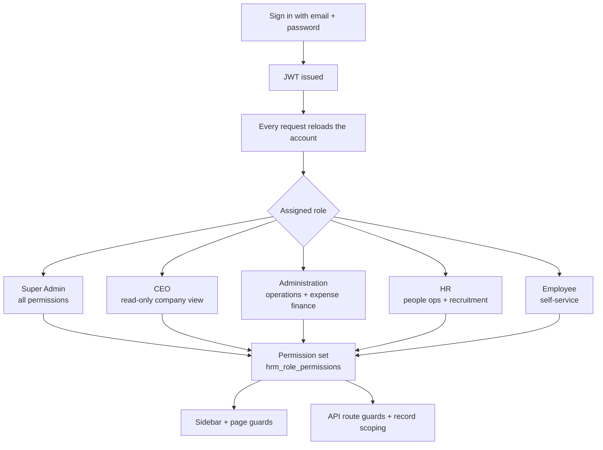
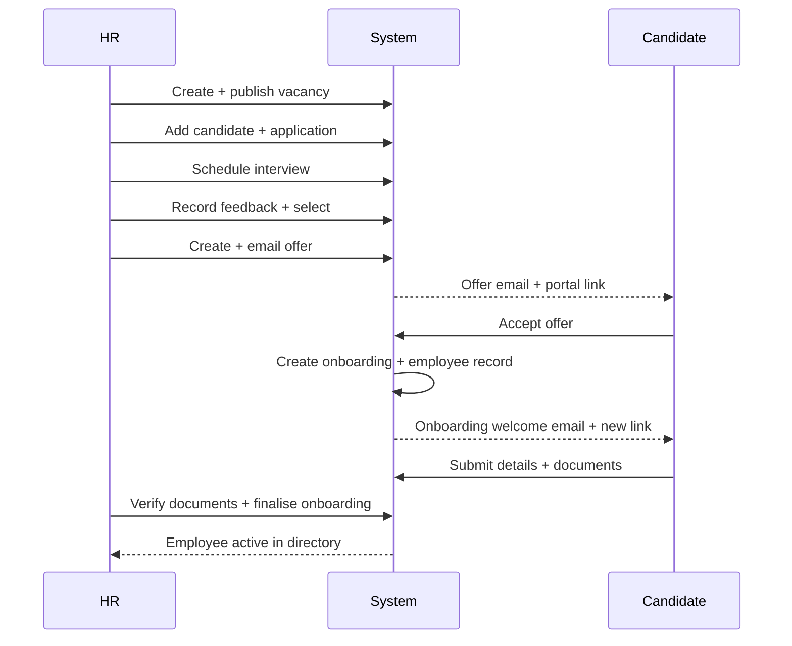
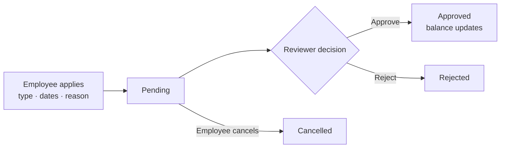
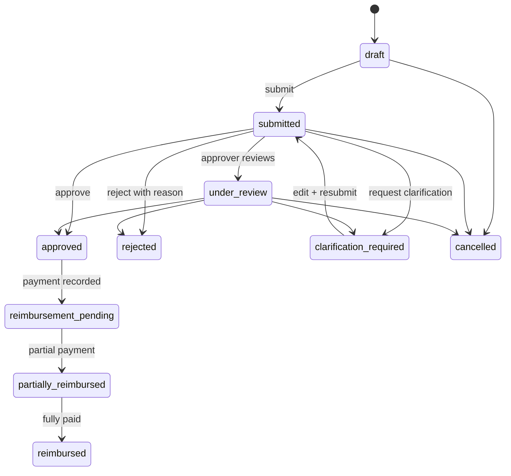
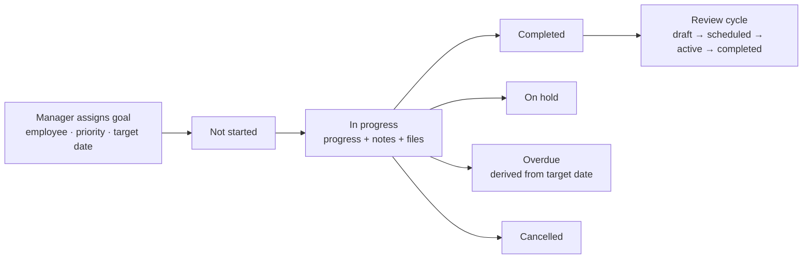

# Kodewar HRMS

**A complete people-operations platform — from the first job posting to the final relieving letter.**

Kodewar HRMS is a full-stack HR management system with a React front end and an Express + MySQL API. It covers the entire employee lifecycle: recruitment, onboarding, core HR, attendance, leave, payroll, expenses, performance, offboarding, and system administration.

> **Stack:** React 18 · Vite · Tailwind CSS · Express · MySQL2 (TiDB compatible) · JWT auth · PDFKit

---

## Contents

1. [What is Kodewar HRMS?](#1-what-is-kodewar-hrms)
2. [Feature catalogue](#2-feature-catalogue)
3. [Roles at a glance](#3-roles-at-a-glance)
4. [Full access matrix](#4-full-access-matrix)
5. [Login-by-login guide](#5-login-by-login-guide)
6. [Visual workflows](#6-visual-workflows)
7. [Getting started](#7-getting-started)
8. [Scripts](#8-scripts)
9. [Project structure](#9-project-structure)
10. [API overview](#10-api-overview)
11. [Security & guardrails](#11-security--guardrails)
12. [Current boundaries](#12-current-boundaries)

---

## 1. What is Kodewar HRMS?

Kodewar HRMS gives every person in the company a workspace that matches their job:

- **Employees** get self-service: clock in/out, request leave, view payslips, submit expenses, update goals, complete onboarding, and download exit documents.
- **Managers and HR** get operational tools: people records, approvals, payroll, hiring, onboarding, performance cycles, and reports.
- **Leadership** gets company-wide, read-only visibility.
- **Super Admin** controls users, roles, permissions, and the audit trail.

The same permission system drives both the **sidebar navigation** and the **API route guards**, so a role sees only the screens it can actually use.

### The modules

| Area | What it handles |
|---|---|
| **Workspace** | Role-aware dashboard, notifications, personal settings |
| **Core HR** | Employees, departments, attendance, leave, payroll, executive reports |
| **Recruitment** | Vacancies, candidates, pipeline, interviews, feedback, offers, hiring reports |
| **Onboarding** | Templates, checklists, document collection and verification |
| **Offboarding** | Resignations, notice periods, relieving/experience/settlement letters |
| **Expenses** | Claims, receipts, approvals, reimbursements, categories, policy, reports |
| **Performance** | Goals, progress history, review cycles, performance reports |
| **System administration** | Users, role permissions, audit log |

---

## 2. Feature catalogue

### 2.1 Workspace

**Dashboard**
- Two layouts: a **manager dashboard** and an **employee dashboard**, selected automatically.
- Manager view: headcount, present today, pending leave, monthly payroll (when permitted), 6-month headcount trend, today’s attendance mix, department distribution, 7-day attendance chart, leave-approval queue, recent hires, upcoming birthdays.
- Employee view: clock-in/clock-out card, attendance rate, leave balance, pending requests, latest payslip, upcoming time off, department peers.
- Quick actions appear only when the user has the matching permission.
- All figures are trimmed server-side — no payroll numbers without payroll permission, no org data without org-level permission.

**Notifications**
- In-app feed with unread count, All/Unread tabs, mark-one and mark-all-read.
- Notifications are generated from live data and filtered by the recipient’s permissions: leave decisions, payslips, new hires, recruitment activity, onboarding, resignations, expense decisions and reimbursement reminders, goal deadlines/overdue goals, review cycles.
- Clicking a notification opens the related page.

**Settings (own account)**
- Update name, email, and avatar colour.
- Change password (current password required, minimum 8 characters).
- View employee ID, department, join date, access level, and last sign-in.
- Local notification preferences (stored in the browser).

### 2.2 Core HR

**Employees**
- Searchable directory with grid and table views, department/status filters, sorting, and pagination.
- Stat cards: total, active, on leave/probation, new this month.
- Profile modal with Overview, Attendance, Leave, and Payroll tabs.
- Add employee with personal details, employment details, salary, bio, and an optional workspace login (employee role only).
- Edit and delete employees. Deletion is blocked when a login exists or when deleting yourself.
- Salary is hidden unless the viewer has payroll access (or is viewing their own profile).

**Departments**
- Department cards with head, description, member count, and average salary (when permitted).
- Department detail with the full member list.
- Create, edit, and delete departments; assign a department head.
- A department cannot be deleted while it still has members.
- Compensation figures are permission-trimmed.

**Attendance**
- **Manager view:** daily or monthly records, department and status filters, present/late/remote/absent stats, client-side pagination, CSV export, and server-side manual marking/correction.
- **Employee view:** live clock card, check-in/check-out, today’s hours, monthly rate, personal history.
- Late is automatically flagged after 09:15. Check-out calculates hours, deducting lunch for shifts over six hours.
- Duplicate check-ins and double check-outs are rejected.

**Leave**
- **Manager view:** company-wide requests, pending/approved/rejected tabs, leave-type filter, detail modal, approve/reject actions, and the ability to submit leave on behalf of an employee.
- **Employee view:** annual balance ring, sick-leave card, request history, apply for leave, and cancel a pending request.
- Leave types: annual, sick, personal, maternity, unpaid. Overlapping requests, past start dates (for employees), and requests over 60 days are rejected. Balance is computed from approved leave in the current year.

**Payroll**
- **Manager view:** month picker, total payroll/gross/paid/pending/deductions, status filter, payslip table, printable payslip modal, payroll generation, and mark-as-paid.
- Generation creates a payslip for every eligible employee: basic = annual salary ÷ 12, allowances = 12%, deductions = 8%. Existing rows are skipped, so re-running a month is safe.
- **Employee view:** personal payslip with breakdown, payment status, and print.

**Executive reports**
- Read-only company insight: headcount and 6-month trend, attendance rate, pending leave, payroll total (when permitted), department distribution, and workforce health.
- No export by design — it is an executive snapshot.

### 2.3 Recruitment

**Hiring overview**
- Eight KPI cards, hiring funnel, source chart, 12-month hiring trend, department vacancies, recent applications, upcoming interviews, recent hires, and an activity feed.
- CEO and Administration can see the aggregate overview without accessing candidate records. Sections the viewer cannot access are hidden server-side.

**Job vacancies**
- Create and edit vacancies: title, department, employment type, work location, work mode, experience range, salary range, number of openings, application deadline, description, responsibilities, qualifications, and skills.
- Vacancy lifecycle: `draft → open → on-hold → closed`, with publish, hold, close, and reopen actions.
- A vacancy can be deleted only while it is a draft with zero applications. Reopening is blocked once its deadline has passed.
- Search and filter by title, code, location, status, and department; open a vacancy to see its applications.

**Candidates and pipeline**
- Candidate database with contact details, qualification, experience, current company/designation, expected salary, notice period, skills, LinkedIn/portfolio links, source, and resume.
- Add candidates manually, upload a resume, and optionally attach them to a vacancy (creating an application). Candidates with a converted employee record cannot be deleted.
- Kanban pipeline with nine stages:
  `applied → screening → shortlisted → interview_scheduled → interview_completed → selected → offer_sent → hired` (plus `rejected`).
- Stage changes use controlled "Move to" actions — only legal transitions are offered. Rejections require a reason. Recruiter notes and full stage history are preserved.
- `hired` is terminal and can only be reached through the hiring/onboarding flow.

**Interviews**
- Schedule interviews with round type (technical, HR, managerial, final), mode (online, offline, phone), date/time, duration (15–480 minutes), interviewer, location, and notes. Online interviews require a meeting link.
- Scheduling moves the application to `interview_scheduled`; reschedule, cancel, or mark completed. Cancelling the last scheduled interview returns the application to `shortlisted`.
- Record confidential feedback with scores for technical, communication, problem-solving, and overall (1–5), plus strengths, weaknesses, notes, and a recommendation (`strong_hire`, `hire`, `hold`, `reject`).
- Feedback is a separate permission — viewing schedules does not automatically expose evaluations.

**Offers**
- Create offers from selected applications with job title, department, annual salary, salary structure, joining date, probation months, employment type, expiry, and terms.
- Offer lifecycle: `draft → sent → accepted / rejected / expired / withdrawn`.
- Preview and download the offer as a PDF, send it by email with the PDF attached and a candidate-portal link, and track the response.
- Offers can be accepted/rejected by HR or by the candidate in the portal. Withdrawing a sent offer returns the application to `selected`.
- When the candidate accepts in the portal, onboarding starts automatically and the linked employee record is created in **probation**. HR can also record an acceptance and initiate onboarding from the offer detail page.
- An explicit candidate-to-employee conversion API (`recruitment.hire`) also exists for scripted or custom flows.

**Candidate portal**
- Public, tokenised page at `/portal/candidate?token=…`, opened from the offer email. No account or password is needed.
- Shows the offer, lets the candidate accept or decline with a reason, and download the offer PDF.
- After acceptance, the portal gains Onboarding and Document Upload tabs: personal details, education, bank details, and document uploads.
- Links expire after seven days; a fresh link is issued with each invitation or onboarding welcome email.

**Hiring reports**
- Application, interview, offer, and conversion KPIs; pipeline and stage conversion; source effectiveness; 12-month hiring trend; department recruitment; offer outcomes; job-status distribution; and average time from application to hire.

### 2.4 Onboarding

- Onboarding dashboard with total, in-progress, awaiting-verification, and completed metrics, a searchable record list, and status filters.
- Create reusable templates for full-time employees, interns, contractors, and freshers. Each template has categorised tasks (personal information, document verification, employment formalities) with an owner role, due-in days, and mandatory flags.
- Initiate onboarding from an accepted offer, or create a record directly with joining date and designation.
- Record detail has four tabs: **Compliance Checklist**, **Personal & Educational Info**, **Document Vault**, and **Bank & Compensation** (restricted).
- HR can review submissions, verify or reject documents with a reason, and finalise onboarding. Completion sets the employee to active and the record to 100%.
- Employees and candidates see only their own checklist and upload requirements. Sensitive fields are masked for read-only viewers such as the CEO.
- Document types include identity proof, PAN card, address proof, photograph, educational certificates, previous employment, bank proof, signed offer, employment agreement, and other.

### 2.5 Offboarding

**Resignations**
- Employees submit a resignation with resignation date, proposed last working day, notice period (default 30 days), reason, and handover comments.
- HR reviews it through `pending → under_review → approved / rejected`, with a clarification-requested state.
- Approval records the final last working day and updates the notice period. If the approved last day is today or earlier, the employee is marked inactive.
- Rejection waives the notice period. Duplicate active resignation requests are blocked.

**Notice periods**
- Tracks serving employees, submission date, notice duration, expected last working day, approved last working day, and dynamically calculated days remaining.

**Exit documents**
- Generate relieving letters, experience & service certificates, exit-formality confirmations, and final settlement statements as PDFs.
- Each document gets an `EXT-YYYY-NNNN` reference and is downloadable by HR and by the employee it belongs to.

### 2.6 Expenses

**Expense dashboard**
- Personal scope for employees; organisation scope for anyone with `expenses.view_all`.
- Range selector (this month, last month, last 3 months, this year, all time, custom).
- Claims, approvals, rejections, reimbursements, approval rate, monthly trend, category split, department split, recent submissions, and recent reimbursements.

**My expenses**
- Submit a claim with title, category, date, amount, currency, purpose, and receipts.
- Save as draft (when policy allows), edit drafts or clarification-required claims, submit, cancel, and track every status.
- Download a personal PDF expense statement.

**All claims / approvals**
- Organisation-wide claim register with search and filters for employee, department, category, approval status, reimbursement status, date range, and sorting.
- Approver queue excludes the approver’s own claims. Self-approval is blocked.
- Decisions: approve, reject (reason required), or request clarification (message required).
- Claim lifecycle: `draft → submitted → under_review → approved / rejected / clarification_required`, then reimbursement states.

**Reimbursements**
- Record full or partial payments against approved claims with method, reference, date, and notes.
- Payment statuses: pending, processing, partially paid, paid, failed, on hold.
- Cumulative payments can never exceed the approved amount; fully paid claims become `reimbursed` automatically.
- Download a reimbursement CSV statement.

**Categories, policy, reports**
- Categories carry a receipt requirement, optional claim limit, and approval flag. Categories are deactivated, never deleted.
- Policy settings: default currency, receipt threshold, attachment size/count limits, draft allowance, policy footer.
- Reports: summary, by category, by department, by employee, reimbursements, CSV exports, and per-employee PDF statements.

**Receipt rules**
- PDF, JPG, PNG, and WEBP only; 10 MB per file and up to 5 files (policy can lower these).
- Receipts are stored privately outside the web root and served only through authenticated, audited downloads.
- Receipts can be required by category and/or by amount threshold.
- Duplicate receipts (same file hash) and duplicate claims (same employee, amount, date, category) are rejected.

### 2.7 Performance

**Performance dashboard**
- Personal or organisation scope, date-range selector, goals assigned, in progress, completed, pending, overdue, active cycles, completed cycles, 12-month completion trend, status distribution, department progress, and recent activity.

**Goals**
- Create goals for one or many employees: title, description, department, priority (low/medium/high/critical), start and target dates, status, instructions, notes, and attachments.
- Goal statuses: not started, in progress, completed, on hold, overdue, cancelled.
- `overdue` is always derived from the target date — it cannot be set manually.
- Search and filter by status, priority, employee, department, target date, and sort order.
- Employees see and update only their own goals; managers see the organisation.

**Goal progress**
- Slider and numeric progress (0–100) with status, notes, and up to five supporting files.
- Completed forces 100%, not-started forces 0%, and in-progress is clamped to 1–99%.
- Every update writes a history entry (old/new status, old/new percentage, note, author, timestamp); attachments can be tied to a specific update.
- Goal details show timeline, progress history, attachments, linked review cycles, and activity log.
- Cancelling a goal preserves its history and is blocked for completed goals.

**Review cycles**
- Cycle statuses: `draft → scheduled → active → completed` (with `cancelled` available until completion).
- Create cycles with name, description, period (monthly, quarterly, half-yearly, annually, custom), department, dates, and employee membership.
- Cycle KPIs are computed live from member employees’ goals whose target dates fall inside the cycle window.
- Activate, schedule, complete, or cancel from the cycle detail view.

**Review history and reports**
- Historical cycle list with filters and read-only detail for viewers.
- Performance reports across goals, employees, departments, and review cycles.
- CSV and PDF export with the current filters applied (goals rows capped at 5,000 per export).

### 2.8 Administration & security

**Users and access**
- Create users with name, email, temporary password, role, and optional employee link.
- Change roles, activate/deactivate accounts, reset passwords, and delete users.
- Guardrails: cannot deactivate/delete yourself, cannot remove the last active Super Admin, and an employee can be linked to only one login.
- Users without `roles.manage` can create employee accounts only.

**Roles and permissions**
- Every role except Super Admin has an editable permission matrix, grouped by module.
- Saving a role replaces its permission set transactionally and records the added/removed permissions in the audit log.
- Super Admin always has every permission and cannot be edited.

**Audit log**
- Immutable record of sensitive actions: employee/department changes, attendance marking, leave decisions, payroll generation/payment, user and role changes, permission updates, expense and performance administration, document downloads.
- Search and filter by action, role, and free text; paginated results.

---

## 3. Roles at a glance

| Role | Purpose | Default posture |
|---|---|---|
| **Super Admin** | System owner | Every feature, every permission, full configuration |
| **CEO** | Leadership visibility | Company-wide, read-only; own self-service |
| **Administration** | Office and facilities operations | Departments, expense approvals/reimbursements, goal management |
| **HR** | People operations | Employees, attendance, leave, payroll, recruitment, onboarding, offboarding, performance, users |
| **Employee** | Individual contributor | Self-service only |

> **Permissions are data, not code.** `server/src/permissions.js` defines the defaults, but the live permissions are stored in `hrm_role_permissions` and can be changed by a Super Admin in **Access control**. This README documents the **default** setup.
>
> There is no separate "Manager" role. Manager-style capabilities come from permissions such as `employees.view`, `leaves.manage`, or `performance.goals.manage`.

---

## 4. Full access matrix

**Legend:** **Manage** = full create/edit/approve control · **View** = read-only, organisation-wide · **Own** = self-service records only · **—** = no access

| Page / capability | Super Admin | CEO | Administration | HR | Employee |
|---|---|---|---|---|---|
| **Dashboard** | Manage | View | View | View | Own |
| Notifications | ✅ | ✅ | ✅ | ✅ | ✅ |
| Own settings & password | ✅ | ✅ | ✅ | ✅ | ✅ |
| **Employee directory** | Manage | View | View | Manage | Own profile |
| **Departments** | Manage | View | Manage | View | — |
| **Attendance** | Manage | View | View | Manage | Own |
| **Leave requests** | Manage | View | View | Manage | Own |
| **Payroll** | Manage | View | — | Manage | Own payslips |
| **Executive reports** | ✅ | ✅ | ✅ | ✅ | — |
| **Recruitment overview** | ✅ | View | View | ✅ | — |
| Job vacancies | Manage | View | — | Manage | — |
| Candidates & pipeline | Manage | — | — | Manage | — |
| Interviews & feedback | Manage | — | — | Manage | — |
| Offers & hiring | Manage | — | — | Manage | — |
| Recruitment reports | ✅ | View | — | View | — |
| **Onboarding** | Manage | View | — | Manage | Own |
| Onboarding templates | Manage | — | — | Manage | — |
| **Resignations & notice periods** | Manage | View | — | Manage | Own |
| **Exit documents** | Manage | View | — | Manage | Own |
| **Expense dashboard** | ✅ | View | View | View | Own |
| My expenses | ✅ | ✅ | ✅ | ✅ | ✅ |
| All expense claims | ✅ | View | View | View | — |
| Expense approvals | ✅ | — | ✅ | ✅ | — |
| Reimbursements | ✅ | — | ✅ | — | — |
| Expense categories | ✅ | — | — | — | — |
| Expense reports | ✅ | ✅ | ✅ | ✅ | — |
| Expense policy settings | ✅ | — | — | — | — |
| **Performance dashboard** | ✅ | View | View | View | Own |
| Goals | Manage | View | Manage | Manage | Own |
| Goal progress | Manage | View | Manage | Manage | Own |
| Review cycles | Manage | View | View | Manage | Own (member) |
| Review history | ✅ | View | View | ✅ | Own (member) |
| Performance reports | ✅ | ✅ | ✅ | ✅ | — |
| **Access control** | ✅ | — | — | Users only* | — |
| **Audit log** | ✅ | — | — | — | — |

\* By default HR holds `users.manage` but not `roles.manage`. The sidebar shows **Access control** for either permission, while the page route itself requires `roles.manage`. In practice HR sees the menu item but is redirected away; user administration becomes available once `roles.manage` is granted to HR.

---

## 5. Login-by-login guide

The demo accounts below are created by `npm run seed` and are for **local development only**. Never use them in production.

### 5.1 Super Admin — Amelia Hart

`admin@aurorahr.com` · `admin123`

**Sees:** every sidebar section — Workspace, Recruitment, Lifecycle, Expenses, Performance, Insights, System, Account.

**Can do**
- Everything every other role can do, plus:
- Create and manage users, change roles, reset passwords, deactivate accounts.
- Edit the permission matrix for CEO, Administration, HR, and Employee.
- Read the audit log.
- Manage expense categories and expense policy.
- Approve expenses and record reimbursements.
- Perform the final hire conversion, onboarding verification, payroll run, and exit documentation.

**Guardrails**
- The Super Admin role is locked to all permissions and cannot be edited.
- Cannot deactivate, demote, or delete themselves, or the last remaining active Super Admin.

### 5.2 CEO — Olivia Bennett

`ceo@aurorahr.com` · `ceo123456`

**Sees:** Workspace (no Payroll actions), Recruitment (overview, vacancies, reports), Lifecycle (onboarding, resignations, notice periods, exit documents), Expenses (dashboard, my expenses, all claims, reports), Performance (dashboard, goals, progress, review cycles, history, reports), Insights, Account.

**Can do**
- View company-wide dashboards, headcount, attendance, leave, payroll totals, and executive reports.
- Browse employees and departments.
- View recruitment overview, job vacancies, and recruitment reports.
- View onboarding and offboarding progress (without changing it).
- View all expense claims and run expense reports.
- View all goals, review cycles, and performance reports.
- Submit and track their **own** expenses, update their **own** goals, view their own payslips.
- Manage their own profile and password.

**Cannot do**
- Add, edit, or delete employees.
- Approve or reject leave.
- Run payroll or mark payslips paid.
- Approve expenses or record reimbursements.
- Create or edit goals, review cycles, vacancies, offers, or onboarding records.
- Access Access Control or the audit log.

### 5.3 Administration — Benjamin Clarke

`office@aurorahr.com` · `office123456`

**Sees:** Workspace (no Payroll), Recruitment (hiring overview only), Expenses (dashboard, my expenses, all claims, approvals, reimbursements, reports), Performance (dashboard, goals, progress, review cycles, history, reports), Insights, Account.

**Can do**
- View the employee directory and employee profiles.
- Create, edit, and delete departments; assign department heads.
- View organisation-wide attendance and leave (read-only).
- Submit and track their own expenses.
- Approve or reject expense claims and request clarification.
- Record full or partial reimbursements and update payment status.
- Manage employee goals (create, assign, edit, cancel) and update progress.
- View review cycles and performance reports.
- View the recruitment overview and executive reports.

**Cannot do**
- Manage employee records.
- Clock in/out, apply for leave, or view personal payslips (the Administration role has view-all attendance/leave but no `attendance.self`, `leaves.self`, or payroll permission by default).
- Approve leave (view only).
- Access payroll at all.
- Manage vacancies, candidates, interviews, offers, onboarding, or offboarding.
- Manage review cycles (view only).
- Access system administration or the audit log.
- Manage expense categories or policy.

### 5.4 HR — Grace Kim

`hr@aurorahr.com` · `hr123456`

**Sees:** Workspace (all), Recruitment (all), Lifecycle (all), Expenses (dashboard, my expenses, all claims, approvals, reports), Performance (all), Insights, System (Access control menu), Account.

**Can do**
- Add, edit, and delete employees, including creating an employee workspace login.
- View departments; manage users.
- View and manage attendance, including manual marking.
- View, approve, and reject leave; apply on behalf of employees.
- View payroll, generate a month, and mark payslips paid.
- Run the full recruitment lifecycle: vacancies, candidates, pipeline, interviews, feedback, offers, and candidate conversion through onboarding.
- Run onboarding: templates, initiation, verification, and completion.
- Run offboarding: approve resignations, track notice periods, issue exit documents.
- View all expense claims, approve/reject them, and run expense reports.
- Manage goals and review cycles; view performance reports.
- View executive reports.
- Submit their own leave, expenses, and goals.

**Cannot do (by default)**
- Record expense reimbursements.
- Manage expense categories or policy.
- Edit roles and permissions, or open Access Control (menu appears, but the page requires `roles.manage`).
- View the audit log.
- Edit the Super Admin role.

### 5.5 Employee — Sarah Chen

`sarah@aurorahr.com` · `employee123`

**Sees:** Workspace (dashboard, attendance, leave, payroll), Lifecycle (onboarding, resignations, notice periods, exit documents), Expenses (dashboard, my expenses), Performance (dashboard, goals, progress, review cycles, review history), Account.

**Can do**
- Clock in and out and view personal attendance history and monthly stats.
- Apply for leave, see balances, and cancel a pending request.
- View and print personal payslips.
- Submit expense claims with receipts, edit drafts, cancel pending claims, track approvals and reimbursements, and download a personal statement.
- View and update **own** goals, add progress notes and attachments, and see goal history.
- View review cycles they are a member of.
- Complete onboarding tasks and upload documents.
- Submit a resignation and download personal exit documents.
- Receive notifications and manage their own profile/password.

**Cannot do**
- See other employees, departments, or org-wide attendance/leave/payroll.
- Access recruitment, reports, approvals, or system administration.
- View or edit anyone else’s goals or review cycles.

---

## 6. Visual workflows

### 6.1 Master employee lifecycle

```mermaid
flowchart LR
    A["Job vacancy<br/>draft → open"] --> B["Candidate<br/>added / applies"]
    B --> C["Pipeline<br/>applied → screening → shortlisted"]
    C --> D["Interviews<br/>scheduled → completed + feedback"]
    D --> E["Selected"]
    E --> F["Offer<br/>draft → sent"]
    F --> G{"Candidate response"}
    G -- Accepts --> H["Onboarding + employee record<br/>probation · details + documents"]
    G -- Declines --> X["Offer rejected / withdrawn"]
    H --> I["Document verification<br/>HR finalises onboarding"]
    I --> J["Active employee<br/>attendance · leave · payroll · expenses · goals"]
    J --> K["Resignation<br/>submitted"]
    K --> L["Review + notice period"]
    L --> M["Exit documents<br/>relieving · experience · settlement"]
    M --> N["Offboarded"]
```



### 6.2 How access is decided



### 6.3 Hire-to-onboard

1. **HR** creates a vacancy and publishes it.
2. **HR** adds a candidate, links them to the vacancy, and moves the application through screening and shortlisting.
3. **HR** schedules interviews; interviewers record scores and feedback.
4. **HR** moves the candidate to *selected*, creates the offer, previews the PDF, and emails it.
5. The **candidate** opens the tokenised portal link, reviews and accepts — or declines with a reason.
6. On acceptance, Kodewar HRMS creates the onboarding record, checklist tasks, and the linked employee record in **probation**, then emails an onboarding link.
7. The **candidate** submits personal, education, and bank details and uploads documents in the portal.
8. **HR** verifies each document, resolves rejections, and finalises onboarding.
9. The employee becomes **active**, appears in the employee directory, and is eligible for payroll.



### 6.4 Leave approval



### 6.5 Expense claim and reimbursement



### 6.6 Attendance and payroll

1. Employee clocks in; the system marks **late** after 09:15.
2. Employee clocks out; hours are calculated with a lunch deduction over six hours.
3. HR can correct or mark records manually.
4. HR selects a payroll month and generates payslips for eligible employees.
5. HR marks individual payslips **paid**.
6. Employees see the payslip and can print it.

### 6.7 Goal and review cycle



### 6.8 Resignation-to-exit

1. Employee submits a resignation with a proposed last working day and reason.
2. HR reviews: under review → clarification requested → approved or rejected.
3. Approval records the final last working day and creates the notice-period record.
4. HR monitors serving employees and expected last days.
5. HR generates the relieving letter, experience certificate, exit confirmation, and/or final settlement statement.
6. The employee downloads their own documents.

---

## 7. Getting started

### Prerequisites

- Node.js 20+
- A MySQL-compatible database (local MySQL or TiDB Cloud)

### Setup

```bash
# 1. Install dependencies (single shared package)
npm install

# 2. Create .env from .env.example and fill in your database details

# 3. Optional: create schema + demo data in a disposable database
npm run seed

# 4. Run API and web app together
npm run dev
```

| Service | URL |
|---|---|
| Web app | <http://localhost:5173> |
| API | <http://localhost:4001/api> |
| Health check | <http://localhost:4001/api/health> |

### Environment

`.env` at the project root:

```env
DB_HOST=your-database-host
DB_PORT=4000
DB_USER=your-database-user
DB_PASSWORD=your-database-password
DB_NAME=aurora_hr
DB_SSL=true
JWT_SECRET=replace-with-a-long-random-secret
PORT=4001
```

### Demo accounts

| Name | Email | Password | Role |
|---|---|---|---|
| Amelia Hart | `admin@aurorahr.com` | `admin123` | Super Admin |
| Olivia Bennett | `ceo@aurorahr.com` | `ceo123456` | CEO |
| Benjamin Clarke | `office@aurorahr.com` | `office123456` | Administration |
| Grace Kim | `hr@aurorahr.com` | `hr123456` | HR |
| Sarah Chen | `sarah@aurorahr.com` | `employee123` | Employee |

The seed script also creates departments, 30 employees, attendance history, leave requests, payroll months, recruitment data, onboarding records, and the default permission matrix.

> **Warning:** `npm run seed` **drops and recreates** application tables. Run it only against a disposable local database. For an existing database, use the additive migrations below.

### Upgrading an existing database

```bash
npm run migrate:roles          # roles + permission matrix
npm run migrate:recruitment    # recruitment tables
npm run migrate:phase3         # onboarding + offboarding tables
npm run migrate:expenses       # expense tables, categories, settings
npm run migrate:performance    # performance tables
npm run migrate:notifications  # notification table
```

---

## 8. Scripts

| Command | Description |
|---|---|
| `npm run dev` | Run API and Vite dev server together |
| `npm run dev:api` | API only (`node --watch`) |
| `npm run dev:web` | Frontend only |
| `npm test` | API tests + fixture-backed browser tests |
| `npm run test:api` | Backend route/auth/permission tests |
| `npm run test:api:watch` | API tests in watch mode |
| `npm run test:coverage` | API tests with coverage |
| `npm run test:browser` | Playwright browser tests |
| `npm run seed` | Rebuild schema and seed demo data |
| `npm run migrate:*` | Additive module migrations |
| `npm run build` | Production build into `client/dist` |
| `npm start` | Start the API in production mode |
| `npm run preview` | Preview the production build |

The project uses **one `package.json` and one shared `node_modules`** at the root. `client/` and `server/` are source directories.

Default tests do not touch a real database: API tests import the real Express app with an in-memory pool double, and browser tests use role-aware API fixtures.

---

## 9. Project structure

```
hrms/
├─ client/                    # React + Vite + Tailwind frontend
│  └─ src/
│     ├─ components/          # Layout, navigation, UI kit
│     ├─ context/             # Auth + toast providers
│     ├─ lib/                 # API client, formatters, module helpers
│     └─ pages/               # Core HR, recruitment, onboarding,
│                             # offboarding, expenses, performance, portal
├─ server/                    # Express API
│  └─ src/
│     ├─ routes/              # Route modules + recruitment sub-routes
│     ├─ middleware/          # JWT auth + permission guards
│     ├─ services/            # PDF, mail, documents, automation
│     ├─ uploads/             # Private receipts, resumes, performance files
│     ├─ permissions.js       # Roles + permission catalogue (source of truth)
│     ├─ *-schema.js          # Module schemas
│     ├─ seed.js              # Schema + demo data
│     ├─ migrate-*.js         # Additive migrations
│     └─ index.js             # Server entry
├─ tests/                     # API + Playwright suites
├─ vite.config.js             # Vite root = client/, proxies /api → 4001
├─ tailwind.config.js
├─ package.json               # Single package for both sides
└─ .env.example
```

---

## 10. API overview

All endpoints are prefixed with `/api` and require `Authorization: Bearer <token>` except `POST /auth/login`, the health check, and the tokenised candidate portal.

| Group | Base path | Highlights |
|---|---|---|
| Auth | `/auth` | login, me, profile, password |
| Dashboard | `/dashboard` | role-aware payload |
| Employees | `/employees` | list, profile, create, update, delete, options |
| Departments | `/departments` | list, detail, create, update, delete |
| Attendance | `/attendance` | records, today, check-in, check-out, mark |
| Leaves | `/leaves` | list, apply, approve/reject, cancel |
| Payroll | `/payroll` | list, payslip, generate, mark paid |
| Notifications | `/notifications` | feed, unread count, read, read-all |
| Users / Access | `/users`, `/access` | users, roles, permission matrix |
| Audit | `/audit` | filtered audit trail |
| Recruitment | `/recruitment` | jobs, candidates, applications, interviews, feedback, offers, reports |
| Onboarding | `/onboarding` | records, templates, tasks, documents, verification |
| Offboarding | `/offboarding` | resignations, notice periods, exit documents |
| Candidate portal | `/portal/candidate` | tokenised offer, onboarding, documents |
| Expenses | `/expenses` | claims, approvals, reimbursements, categories, settings, reports |
| Performance | `/performance` | goals, progress, review cycles, reports, exports |

Every module route is protected by a permission guard (`requirePermission` or `requireAnyPermission`), and record-level checks restrict employees to their own data. Frontend guards are a convenience; the API is the source of enforcement.

---

## 11. Security & guardrails

- **JWT authentication** with the account reloaded on every request, so role changes and deactivations take effect immediately.
- **Permission checks on both sides** — sidebar visibility and page guards on the client, route guards on the server.
- **Super Admin bypass** is explicit and the role is locked; roles are otherwise fully data-driven.
- **Self-scoping** for employees on attendance, leave, payroll, expenses, goals, onboarding, and offboarding.
- **No self-approval** of expense claims; expense approvals are also excluded from the approver’s own queue.
- **No last-admin removal** — the final active Super Admin cannot be deactivated, demoted, or deleted.
- **No self-deletion or self-deactivation.**
- **Department deletion** is blocked while members remain.
- **Employee deletion** is blocked when a workspace login exists.
- **Private uploads** — receipts, resumes, and performance files are stored outside the web root and served through authenticated, permission-checked endpoints.
- **Upload validation** — MIME allow-lists, size/count limits, random stored filenames, SHA-256 hashes, and path-traversal protection.
- **Duplicate protection** — duplicate receipts, duplicate claims, duplicate offers, and duplicate user/employee links are rejected.
- **Audit trail** for sensitive administrative and financial actions, including receipt and statement downloads.
- **Transactional writes** for multi-step operations such as hire conversion, goal updates, cycle changes, permission saves, and reimbursements.

---

## 12. Current boundaries

Useful to know before deploying:

- **Expenses are tracking-only.** There is no payment gateway or money movement; reimbursements are manually recorded.
- **In-app notifications** cover expenses and performance; recruitment offers and candidate invitations also send email. Expense/performance activity does not send email.
- **Role permissions are defaults.** A Super Admin can change them, so the matrix in this README reflects the seeded configuration.
- **No manager hierarchy.** Approvals are permission-based, not routed by reporting line.
- **Expense categories cannot be deleted**, only deactivated, to preserve claim history.
- **Performance cycle membership and statistics are dynamic** — editing cycle dates recalculates coverage.
- **Notification preferences in Settings are browser-local**, not stored server-side.
- **HR’s Access Control menu item** is visible through `users.manage`, but the page route requires `roles.manage`; grant that permission if HR should manage roles too.
- **Offer expiry is not automatic.** An expired offer must be moved to `expired` manually.
- **Onboarding templates can be created and reused**, but there is no template edit or delete action in the current UI.
- **Candidate portal links are bearer links.** Anyone with the link can act for that candidate until it expires (seven days), so treat the link like a password.

---

Built with care — **Kodewar HRMS**, people beautifully managed.
